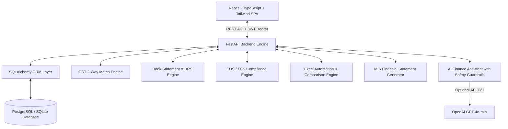

# SmartFin AI – Finance & Office Automation System

> **Enterprise AI-Powered Financial SaaS & Corporate Office Automation Platform**  
> Built for CFOs, Chartered Accountants, Tax Auditors, and Finance Operations Teams.

---

## 📌 Executive Summary

**SmartFin AI** is a production-grade, full-stack financial enterprise resource planning (ERP) and automation system engineered to eliminate repetitive manual bookkeeping, reconciliation errors, and statutory tax compliance overhead.

The platform provides centralized, automated engines for **GST 2-way reconciliation**, **Vendor and Customer accounts aging & ledger matching**, **TDS/TCS statutory deduction and Form 26Q filing preparation**, **Bank statement BRS calculation**, **Excel workflow automation pipelines**, **Executive MIS reporting**, and an **Advisory AI Finance Assistant** grounded strictly on live company ledgers.

---

## 🏗️ Architecture & Technology Stack



### 1. Frontend
- **Framework:** React.js 18 with TypeScript
- **Styling:** Tailwind CSS (Enterprise Navy & Professional Blue Palette)
- **Data Visualization:** Recharts (Revenue Trends, Cost of Goods, Expense Pie Charts)
- **Icons:** Lucide React
- **Build Tool:** Vite

### 2. Backend
- **Framework:** Python 3.9+ / FastAPI
- **Data Processing:** Pandas, NumPy, OpenPyXL, XlsxWriter, PyPDF
- **Security:** Bcrypt (12 rounds), Python-Jose (JWT HS256), Role-Based Access Control (RBAC)
- **ORM & Database:** SQLAlchemy 2.0 with PostgreSQL (Production) and portable SQLite (Local testing)
- **Testing:** Pytest (11/11 automated unit & integration tests)

---

## 🗄️ Database Schema & Relational Models

The relational database architecture is structured into 17 tables:

1. **`users`**: Enterprise auth credentials, roles (`admin`, `accountant`, `manager`, `employee`), departments, status.
2. **`employees`**: Personnel records, designation, joining date, salary, department.
3. **`vendors`**: Supplier records, GSTIN, PAN, bank account, payment credit terms (days), outstanding payables.
4. **`customers`**: Client records, GSTIN, credit limit, trade receivables balance.
5. **`bank_accounts`**: Corporate bank accounts (HDFC, ICICI), IFSC, opening and current balances.
6. **`invoices`**: Purchase & Sales tax invoices with taxable value, CGST, SGST, IGST, total amount, TDS deducted, payment status.
7. **`purchases`**: Inward supply ledger entries and PO references.
8. **`sales`**: Outward supply ledger entries and SO references.
9. **`payments`**: Dual-entry payment vouchers and customer receipts linked to bank accounts.
10. **`bank_transactions`**: Bank statement feeds, debit/credit entries, UTR reference numbers, reconciliation status.
11. **`gst_records`**: Purchase register and GSTR-2B inward supplies, return periods, matching categories, difference amounts, human approval notes.
12. **`tds_records`**: Statutory sections (`194C`, `194J`, `194I`, `194Q`, `206C`), base turnover, expected vs actual deductions, deposit due dates, challan 281 mapping.
13. **`reconciliation_jobs`**: Job status, execution time, match counts, and total discrepancy amounts.
14. **`reconciliation_results`**: Granular record-level comparison results with confidence scores.
15. **`expenses`**: Office expense claims, bills/receipts, approval workflow.
16. **`tasks`**: Kanban tasks, priorities, employee assignees, due dates.
17. **`documents`**: Central document repository with category tags and role access control.
18. **`excel_workflow_templates`**: Reusable data cleaning, deduplication, and comparison workflow presets.
19. **`audit_logs`**: Immutable audit logs capturing every user login, file upload, reconciliation, and export event.
20. **`notifications`**: Real-time user alerts for tax mismatches, pending approvals, and BRS items.

---

## 🚀 Quickstart & Local Setup Instructions

### Prerequisites
- Python 3.9+
- Node.js v18+ and npm

### Step 1: Clone and Set Up the Backend
```bash
# Navigate to backend directory
cd backend

# Create virtual environment
python3 -m venv venv
source venv/bin/activate  # On Windows: venv\Scripts\activate

# Install dependencies
pip install -r requirements.txt

# Run automated tests
pytest tests/ -v

# Start FastAPI Server (Auto-seeds demo database on initial boot)
uvicorn app.main:app --reload --port 8000
```
Backend API will be live at: `http://localhost:8000`  
Interactive Swagger API Docs: `http://localhost:8000/docs`

---

### Step 2: Set Up and Run the Frontend
```bash
# In a new terminal, navigate to frontend directory
cd frontend

# Install npm dependencies
npm install

# Start Vite Development Server
npm run dev
```
Frontend Web Dashboard will be live at: `http://localhost:5173`

---

## 👥 Demo Profiles & Credentials

The platform includes pre-seeded enterprise demo records. You can log in using either the credentials below or click any of the **1-Click Instant Demo Profiles** on the login screen or in the top navigation bar:

| Role | Email | Password | Primary Permissions |
| :--- | :--- | :--- | :--- |
| **Admin (CFO)** | `admin@smartfin.ai` | `admin123` | Full system access, approvals, user management, audit trails |
| **Lead Accountant** | `accountant@smartfin.ai` | `account123` | GST, TDS, BRS, Vendor/Customer ledger, MIS export |
| **Finance Manager** | `manager@smartfin.ai` | `manager123` | Executive dashboards, expense approvals, MIS reports |
| **Office Executive** | `employee@smartfin.ai` | `employee123` | Tasks, attendance logs, personal expense submissions |

---

## 🔍 Module-by-Module Functional Overview

### 1. Centralized Executive Dashboard
- **Calculated KPIs:** Live computed values from database records for Sales Revenue, Cost of Goods, Net Profit, Liquid Bank Balances, GST Output/Input tax, Trade Receivables, and Vendor Payables.
- **Charts:** Interactive Recharts monthly trends, sales vs purchases comparison, and expense category breakdown.
- **Action Items:** Pending expense vouchers, unverified GST discrepancies, and recent security audit trails.

### 2. GST 2-Way Reconciliation Engine
- Upload accounting **Purchase Register** and Govt portal **GSTR-2B** files (Excel/CSV).
- Auto-matching logic compares GSTIN, normalized invoice numbers, dates, and tax components within a ₹1 rounding tolerance.
- Categorizes records into:
  - `Fully Matched` (Eligible for 100% ITC claim)
  - `Partially Matched` (Minor rounding differences)
  - `Missing in GSTR-2B` (Supplier hasn't filed GSTR-1; ITC at statutory risk u/s 16(2)(aa))
  - `Missing in Books` (Unclaimed ITC on portal)
  - `Tax Amount Mismatch` (Rate variations)
  - `Duplicate Invoices`
- Human verification workflow: Disallow or approve exceptions with auditor remarks.
- Export styled Excel reconciliation report.

### 3. Vendor & Customer Accounts Reconciliation
- **Vendor Ledger:** Tracks purchases, payments, aging buckets (0-30, 31-60, 61-90, >90 days overdue), and statement imports.
- **Customer Receivables:** Live credit limit utilization bars, sales invoices vs collections, and debtor aging.

### 4. TDS / TCS Statutory Compliance & Form 26Q Prep
- Configurable statutory rules:
  - **Section 194C:** Contractors (1% Individual, 2% Company; threshold ₹30k/₹100k)
  - **Section 194J:** Professional (10%) & Technical (2%) fees (threshold ₹30k)
  - **Section 194I:** Rent (Plant 2%, Building 10%; threshold ₹240k/yr)
  - **Section 194Q:** Purchase of Goods > ₹50L (0.1%)
  - **Section 206C(1H):** TCS on Sale of Goods > ₹50L (0.1%)
- Automated detection of **Short Deductions** and **Late Deposits** (flags interest penalty u/s 201(1A) @ 1.5%/month).
- Map Challan 281 BSR codes and challan numbers for instant Form 26Q filing readiness.
- Download Form 26Q Excel workbook.

### 5. Bank Reconciliation Statement (BRS) Engine
- Support for multi-bank accounts (Current, Overdraft, Savings).
- Upload bank statement files (Excel/CSV).
- Auto-matching engine matches book vouchers against bank withdrawals/deposits by UTR/cheque reference numbers or amount with configurable clearance date tolerance (±4 days).
- Auto-identifies bank service charges and sweep interest credits.
- Generates mathematical **Bank Reconciliation Statement (BRS)**:
  $$\text{Bank Balance} + \text{Uncredited Deposits} - \text{Unpresented Cheques} - \text{Unbooked Bank Charges} + \text{Unbooked Interest} = \text{Book Balance}$$
- Export BRS report to Excel.

### 6. Office & Operations Management
- **Expense Claims:** Category-wise reimbursement requests with approval/rejection buttons.
- **Task Management:** Interactive 4-column Kanban board (`To-Do`, `In Progress`, `Review`, `Completed`) with priority tags and due dates.
- **Personnel & Attendance:** Employee directory and monthly check-in/out attendance logs.
- **Documents:** Categorized repository for contracts, statements, and tax files.

### 7. Excel Workflow Automation Engine
- **File Inspector:** Scans column schemas, data types, null percentages, and duplicate counts.
- **Transformation Pipeline:** Toggleable rules for deduplication, date normalization (`YYYY-MM-DD`), currency parsing (handles `₹`, `$`, commas, `(500)` negatives), and dropping blank rows.
- **2-Sheet Comparator:** Compares master books vs external statements by unique key, highlighting additions, deletions, and cell-level modifications with custom tolerance.
- **Templates:** Reusable workflow presets.
- **Download Cleaned:** Exports styled, auto-width Excel workbooks.

### 8. MIS Reporting Management
- Automated **Statement of Profit & Loss** (Sales - COGS = Gross Profit - OpEx = Net Profit).
- Automated **Cash Flow Statement** (Customer collections vs Vendor outflows vs Expenses).
- Flexible time periods: **Daily**, **Weekly**, **Monthly**, or **Custom Date Ranges**.
- Multi-tab formatted Excel export powered by OpenPyXL.

### 9. AI Finance Assistant
- Conversational chat drawer accessible globally via the top bar or dedicated full-page view.
- Live database awareness: Queries pending vendor payables, unmatched bank items, GST ITC risks, customer receivables, and expenses.
- **Safety Guardrail:** Strictly advisory. Traceable source records are explicitly cited, and the AI cannot execute destructive database updates or submit statutory returns autonomously.

---

## 🧪 Automated Test Suite

Run the full pytest suite from the repository root:
```bash
PYTHONPATH=backend backend/venv/bin/pytest backend/tests/ -v
```

### Verified Test Cases:
```
backend/tests/test_api_and_engines.py::test_health_check PASSED
backend/tests/test_api_and_engines.py::test_auth_login_admin PASSED
backend/tests/test_api_and_engines.py::test_auth_login_invalid_password PASSED
backend/tests/test_api_and_engines.py::test_dashboard_summary PASSED
backend/tests/test_api_and_engines.py::test_gst_reconciliation_engine PASSED
backend/tests/test_api_and_engines.py::test_bank_reconciliation_engine PASSED
backend/tests/test_api_and_engines.py::test_tds_engine_compliance PASSED
backend/tests/test_api_and_engines.py::test_excel_automation_cleaning PASSED
backend/tests/test_api_and_engines.py::test_excel_sheet_comparison PASSED
backend/tests/test_api_and_engines.py::test_mis_report_generator PASSED
backend/tests/test_api_and_engines.py::test_ai_finance_assistant PASSED

======================== 11 passed in 1.92s ========================
```

---

## ☁️ Deployment Guide (Render)

SmartFin AI is configured for 1-click turnkey deployment on [Render](https://render.com) using the included `render.yaml` blueprint:

1. Push this repository to GitHub or GitLab.
2. In the Render Dashboard, click **New +** → **Blueprint**.
3. Select your repository. Render will automatically provision:
   - **PostgreSQL Database** (`smartfin-db`)
   - **Python FastAPI Web Service** (`smartfin-ai-backend`)
   - **Static Site Web Service** (`smartfin-ai-frontend`)
4. In the backend service environment variables, add your `OPENAI_API_KEY` (optional, for GPT-4o-mini features).
5. Click **Apply**. The platform will build and deploy within minutes.

Alternatively, build and run via Docker:
```bash
docker build -t smartfin-ai .
docker run -p 8000:8000 smartfin-ai
```

---

## 🔒 Security & Statutory Compliance

- **Password Hashing:** Direct 12-round salted Bcrypt encryption.
- **Session Security:** Stateless JWT tokens with 24-hour expiration.
- **Access Control:** Role-Based Access Control (`admin`, `accountant`, `manager`, `employee`).
- **Audit Trails:** Immutable database logging of all financial operations with IP and user timestamps.
- **Statutory Guardrails:** Automated reconciliation engines provide discrepancy alerts and requires authorized human approval before any final entry or statutory submission.

---

*SmartFin AI – Transforming corporate finance through precision automation and verified intelligence.*
